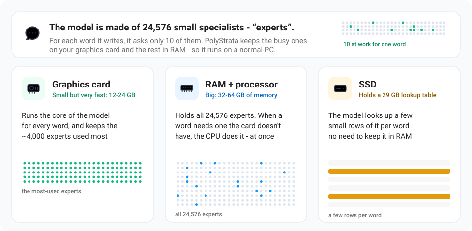

<h1 align="center">PolyStrata</h1>

[English](README.md) · [简体中文](README.zh-CN.md) · [日本語](README.ja.md) · [Deutsch](README.de.md) · [Français](README.fr.md) · **Español** · [Português](README.pt-BR.md)

<p align="center"><b>Ejecuta modelos de IA grandes en tu propio PC</b><br>
Qwen3.8-Flash-Next, GLM 5.3 Flash, Qwen3.6, Ornith 1.5 y Gemma 4 · libre y de código abierto</p>

<p align="center"><a href="https://github.com/Niko1221/Strata/releases/download/v0.1.10/Pagoda.mp4"></a><br>
<sub>Un jardín con una pagoda de vóxeles, hecho con un solo prompt en una RTX 5070 con <a href="https://github.com/Niko1221/Strata">Strata</a> (Qwen3.8-Flash-Next IQ3_S, contexto de 128K) ·
<a href="https://github.com/Niko1221/Strata/releases/download/v0.1.10/Pagoda.mp4">vídeo completo (49 s)</a></sub></p>

PolyStrata ejecuta modelos de IA grandes en un PC normal, modelos que normalmente necesitan un servidor.
Conversan, escriben código y funcionan con tus aplicaciones y agentes de programación. Nada sale de tu PC.

Ejecuta cinco modelos, con dos motores:

- **[Qwen3.8-Flash-Next](https://huggingface.co/Qwen/Qwen3.8-Flash-Next)** en una tarjeta gráfica NVIDIA o AMD de
  12 GB o más, en Windows o Linux. También entiende imágenes. Su motor es el de
  [Strata](https://github.com/Niko1221/Strata), sin cambios.

Los otros cuatro usan un motor escrito para PolyStrata, en Linux con una tarjeta NVIDIA. Son experimentales: solo
han funcionado en un PC, con una tarjeta de 32 GB.

- **[GLM 5.3 Flash](docs/GLM.md)**, el más grande: un archivo de 79 a 114 GB, que en su mayor parte se queda en la RAM.
- **[Qwen3.6-35B-A3B](docs/BACKENDS.md)**, un archivo de 17 GB. También entiende imágenes.
- **[Ornith 1.5](docs/BACKENDS.md)**, con la arquitectura de Qwen3.6-35B-A3B y otros pesos: un archivo de 17 GB.
  También entiende imágenes.
- **[Gemma 4 26B-A4B](docs/BACKENDS.md)**, un archivo de 13 GB. También entiende imágenes.

El servidor puede cambiar entre los modelos instalados mientras está en marcha
([cómo](docs/BACKENDS.md#changing-the-model), en inglés).

PolyStrata está hecho sobre [Strata](https://github.com/Niko1221/Strata) de Niko1221.

## ¿Qué velocidad tiene?

Un token es más o menos ¾ de una palabra.

- **Escribe respuestas:** lo rápido que aparece la respuesta en un chat corto. 60 tokens por segundo es más rápido de lo que puedes leer.
- **Lee tu prompt:** lo rápido que procesa lo que le envías (aquí, un documento, código o historial de chat de 32K tokens).

### Qwen3.8-Flash-Next

Medido por [Strata](https://github.com/Niko1221/Strata) en dos PC gaming corrientes, con un prompt de 32K tokens.

<table>
<tr><th>NVIDIA: RTX 5070 (12 GB), Ryzen 5 7600, 64 GB RAM</th><th>AMD: RX 9070 XT (16 GB), Ryzen 9 3900X, 47 GB RAM</th></tr>
<tr><td>

| Tamaño | Escribe respuestas | Lee tu prompt |
| --- | ---: | ---: |
| **Q2_0** | 94 tokens/s | 2,650 tokens/s |
| **IQ2_XS** | 79 tokens/s | 2,090 tokens/s |
| **IQ3_XXS** | 62 tokens/s | 1,750 tokens/s |
| **IQ3_S** | 53 tokens/s | 1,620 tokens/s |
| **Coder** | 55 tokens/s | 2,180 tokens/s |

</td><td>

| Tamaño | Escribe respuestas | Lee tu prompt |
| --- | ---: | ---: |
| **Q2_0** | 60 tokens/s | 1,160 tokens/s |
| **IQ2_XS** | 52 tokens/s | 1,110 tokens/s |
| **Coder** | 44 tokens/s | 1,420 tokens/s |

</td></tr>
</table>

NVIDIA: Q2_0 con el motor 0.1.36, las demás filas con 0.1.26 (respuestas de 4K, prompts de 32K). Las tablas
completas están en [DETAILS.md](docs/DETAILS.md#speed-measured). Una tarjeta con más VRAM es más rápida: una
RTX 3090 (24 GB) debería escribir unos 100-140 tokens por segundo. Chats largos y otras tarjetas:
[velocidad de cada modelo](docs/MODELS.md#how-fast-is-each-size), [resultados de la comunidad](docs/COMMUNITY_BENCHMARKS.md).

### GLM 5.3 Flash

Medido para PolyStrata en una estación de trabajo, con un prompt de 28K tokens.

<table>
<tr><th>NVIDIA: RTX 5090 (32 GB), Xeon Platinum 8470Q (25 vCPU), 120 GB de RAM</th></tr>
<tr><td>

| Tamaño | Escribe respuestas | Lee tu prompt |
| --- | ---: | ---: |
| **3.0BIT** | 58-59 tokens/s | 529-531 tokens/s |
| **UD-IQ2_XXS** (compilación anterior) | 33 tokens/s | 347 tokens/s |
| **REAP50-Q3_K_M** (compilación anterior) | 27 tokens/s | 384 tokens/s |

</td></tr>
</table>

Las filas UD-IQ2_XXS y REAP50-Q3_K_M son de compilaciones anteriores del motor y no se volvieron a medir: sus
archivos ya no están en el PC de pruebas. Con esas dos compilaciones, 3.0BIT escribía 37 y 27 tokens/s y leía 286 y
312.
En el mismo PC, llama.cpp escribió 26 tokens/s con el archivo 3.0BIT y leyó unos 265. GLM 5.3 Flash es un modelo mucho
más grande que los demás, y solo una quinta parte de sus expertos cabe en los 32 GB de esta tarjeta, por eso
escribe más despacio. Qué se midió y cómo: [docs/GLM.md](docs/GLM.md#what-it-was-measured-on) (en inglés).

### Qwen3.6-35B-A3B

Medido para PolyStrata en la misma estación de trabajo, con un prompt de 30K tokens. A la izquierda, la tarjeta
guarda el modelo entero. A la derecha, la misma tarjeta está limitada a 8 GB y la mayoría de los expertos los calcula
el procesador.

<table>
<tr><th>NVIDIA: RTX 5090 (32 GB), Xeon Platinum 8470Q (25 vCPU), 120 GB de RAM</th><th>El mismo PC, con la tarjeta limitada a 8 GB</th></tr>
<tr><td>

| Tamaño | Escribe respuestas | Lee tu prompt |
| --- | ---: | ---: |
| **UD-Q3_K_M** | 307-309 tokens/s | 2,210-2,220 tokens/s |

</td><td>

| Tamaño | Escribe respuestas | Lee tu prompt |
| --- | ---: | ---: |
| **UD-Q3_K_M** | 149-164 tokens/s | 1,970-1,990 tokens/s |

</td></tr>
</table>

La tabla de la derecha no es un PC con una tarjeta de 8 GB: el procesador, la RAM y la velocidad de la tarjeta son
los de esta estación de trabajo. Un prompt más corto se lee más rápido: uno de 10,000 tokens a 3,800 tokens/s con el
modelo entero en la tarjeta. llama.cpp, con el modelo entero en la misma tarjeta, escribió unos 180 tokens/s y leyó
prompts a entre 6,000 y 9,000. Necesita una tarjeta en la que quepa el modelo.

### Ornith 1.5

Medido igual, con el mismo prompt de 30K tokens.

<table>
<tr><th>NVIDIA: RTX 5090 (32 GB), Xeon Platinum 8470Q (25 vCPU), 120 GB de RAM</th><th>El mismo PC, con la tarjeta limitada a 8 GB</th></tr>
<tr><td>

| Tamaño | Escribe respuestas | Lee tu prompt |
| --- | ---: | ---: |
| **APEX-I-COMPACT** | 230 tokens/s | 2,210-2,230 tokens/s |

</td><td>

| Tamaño | Escribe respuestas | Lee tu prompt |
| --- | ---: | ---: |
| **APEX-I-COMPACT** | 136-148 tokens/s | 1,940 tokens/s |

</td></tr>
</table>

Un prompt de 10,000 tokens se lee a 3,800 tokens/s con el modelo entero en la tarjeta. llama.cpp, con el modelo
entero en la misma tarjeta, escribió unos 180 tokens/s y leyó prompts a entre 6,000 y 9,000.

### Gemma 4 26B-A4B

Medido igual, con un prompt de 31K tokens.

<table>
<tr><th>NVIDIA: RTX 5090 (32 GB), Xeon Platinum 8470Q (25 vCPU), 120 GB de RAM</th><th>El mismo PC, con la tarjeta limitada a 8 GB</th></tr>
<tr><td>

| Tamaño | Escribe respuestas | Lee tu prompt |
| --- | ---: | ---: |
| **UD-Q3_K_M** | 259-275 tokens/s | 2,390-2,410 tokens/s |

</td><td>

| Tamaño | Escribe respuestas | Lee tu prompt |
| --- | ---: | ---: |
| **UD-Q3_K_M** | 137 tokens/s | 2,240-2,250 tokens/s |

</td></tr>
</table>

Un prompt de 10,000 tokens se lee a entre 3,300 y 3,500 tokens/s con el modelo entero en la tarjeta. llama.cpp, con
el modelo entero en la misma tarjeta, escribió unos 165 tokens/s y leyó prompts a entre 6,000 y 9,000.

Los cuatro modelos del motor propio de PolyStrata se midieron con su benchmark, que puedes ejecutar en tu PC:
`python polystrata.py benchmark --model <name> --prompt-tokens 24000`
([qué envía y qué imprime](docs/BACKENDS.md#benchmark), en inglés).

## Qué necesitas

### Qwen3.8-Flash-Next

| | |
| --- | --- |
| **Tarjeta gráfica** | **NVIDIA** GeForce serie RTX 20, 30, 40 o 50, o **AMD** Radeon RX 7900 XT / XTX, RX 7800 XT / 7700 XT, RX 9060 XT, RX 9070 / 9070 XT, Radeon AI PRO R9700 o serie RX 6800 / 6900. Necesita **12 GB de VRAM o más**. |
| **RAM** | 32 GB o más. Tu RAM decide [qué modelo](#qué-modelo-elijo) cabe. Con 64 GB funcionan todos los tamaños. |
| **Disco** | Unos 80 GB libres. Usa un SSD si puedes: el primer arranque es mucho más rápido. |
| **Sistema** | Windows 10 / 11 o Linux, y un controlador gráfico actual de NVIDIA o AMD. |

El instalador prepara todo lo demás. Dos o tres tarjetas pueden repartirse el modelo ([multi-GPU](docs/MULTI_GPU.md)).

Experimental, escrito y probado por miembros de la comunidad en sus propios equipos:

- **Tarjetas gráficas antiguas** (Tesla P40 / V100, GTX 10, Radeon VII / MI50, RX 6700 XT, RX 5500 XT): [Older GPUs](docs/OLDER_GPUS.md).
- **Intel Arc**, compilado desde el código fuente en Linux: [Intel Arc](docs/INTEL_ARC.md).
- **Procesadores antiguos sin AVX2**: funcionan, pero despacio. [Older CPUs](docs/INSTALL.md#older-cpus-experimental).

La lista completa: [docs/INSTALL.md](docs/INSTALL.md#what-you-need).

### GLM 5.3 Flash

| | |
| --- | --- |
| **Tarjeta gráfica** | Una tarjeta **NVIDIA** GeForce RTX serie 20 o más nueva. Solo ha funcionado con **32 GB de VRAM**. Unos 12 GB se ocupan antes del primer experto, así que una tarjeta de 12 GB no puede arrancarlo. |
| **RAM** | Junto a una tarjeta de 32 GB, **96 GB o más** para el modelo entero, 82 GB para su tamaño de 2 bits, 60 GB para el tamaño con la mitad de los expertos. Una tarjeta más pequeña necesita más RAM ([cuánta](#qué-modelo-elijo)). Ha funcionado con 120 GB. |
| **Disco** | 114 GB, 102 GB o 79 GB para el archivo del modelo, en un SSD. |
| **Sistema** | Linux y un controlador de NVIDIA actual. |

El instalador se encarga de todo lo demás. Compila el motor en tu PC y ofrece instalar lo que haga falta para eso
(g++ y el CUDA Toolkit). Todavía no: Windows, tarjetas AMD, varias tarjetas, imágenes.

La lista completa: [docs/GLM.md](docs/GLM.md#what-you-need) (en inglés).

### Qwen3.6-35B-A3B

| | |
| --- | --- |
| **Tarjeta gráfica** | Una tarjeta **NVIDIA** GeForce RTX serie 20 o más nueva con **8 GB de VRAM o más**. Unos 5 GB se ocupan antes del primer experto. Ha funcionado en una tarjeta de 32 GB, y en esa tarjeta limitada a 8 GB. |
| **RAM** | Unos **21 GB** junto a una tarjeta de 8 GB, según la estimación del instalador. Una tarjeta de 24 GB guarda el modelo entero. |
| **Disco** | 17 GB para el archivo del modelo, 1 GB más para leer imágenes. |
| **Sistema** | Linux y un controlador de NVIDIA actual. |

El instalador se encarga de todo lo demás, como con GLM 5.3 Flash. Todavía no: Windows, tarjetas AMD, varias tarjetas.

### Ornith 1.5

| | |
| --- | --- |
| **Tarjeta gráfica** | Una tarjeta **NVIDIA** GeForce RTX serie 20 o más nueva con **8 GB de VRAM o más**. Unos 4 GB se ocupan antes del primer experto. Ha funcionado en una tarjeta de 32 GB, y en esa tarjeta limitada a 8 GB. |
| **RAM** | Unos **22 GB** junto a una tarjeta de 8 GB, según la estimación del instalador. Una tarjeta de 24 GB guarda el modelo entero. |
| **Disco** | 17 GB para el archivo del modelo, 1 GB más para leer imágenes. |
| **Sistema** | Linux y un controlador de NVIDIA actual. |

El instalador se encarga de todo lo demás, como con GLM 5.3 Flash. Todavía no: Windows, tarjetas AMD, varias tarjetas.

### Gemma 4 26B-A4B

| | |
| --- | --- |
| **Tarjeta gráfica** | Una tarjeta **NVIDIA** GeForce RTX serie 20 o más nueva con **8 GB de VRAM o más**. Unos 6 GB se ocupan antes del primer experto. Ha funcionado en una tarjeta de 32 GB, y en esa tarjeta limitada a 8 GB. |
| **RAM** | Unos **18 GB** junto a una tarjeta de 8 GB, según la estimación del instalador. Según la misma estimación, una tarjeta de 16 GB guarda el modelo entero. |
| **Disco** | 13 GB para el archivo del modelo y su modelo borrador, 1 GB más para leer imágenes. |
| **Sistema** | Linux y un controlador de NVIDIA actual. |

El instalador se encarga de todo lo demás, como con GLM 5.3 Flash. Todavía no: Windows, tarjetas AMD, varias tarjetas.

Qué necesita cada uno de los tres y cómo se comprobó: [docs/BACKENDS.md](docs/BACKENDS.md#install) (en inglés).

## Instalación

### Deja que tu IA lo instale

¿Usas un asistente de programación con IA (Claude Code, Cursor, Codex, GitHub Copilot, ...)? Pega esto en él:

```text
Set up PolyStrata on this PC for me: https://github.com/VecSzn/PolyStrata - follow docs/AI_SETUP.md in that repository.
```

Revisa tu tarjeta gráfica, tu RAM y tu disco, y elige el modelo que cabe. Luego lo instala, lo arranca y te explica
cómo conectar tus aplicaciones. Las herramientas de IA también pueden instalar, arrancar y detener PolyStrata con su
[servidor MCP](docs/MCP_SERVER.md).

### O hazlo tú mismo

[Descarga PolyStrata](https://github.com/VecSzn/PolyStrata/archive/refs/heads/main.zip) y descomprímelo (o usa `git clone`).
**Windows:** haz doble clic en **`START-HERE.bat`**. **Linux:** ejecuta **`./setup.sh`** en la carpeta de PolyStrata.

Los pasos son los mismos para NVIDIA y AMD. El instalador detecta tu tarjeta y prepara el motor adecuado para ella.
Te hace unas pocas preguntas:

- qué modelo y qué tamaño,
- cuánto contexto (cuánto texto tiene presente el modelo),
- si debe entender imágenes (GLM 5.3 Flash no las entiende).

Pulsa Enter cada vez para usar la respuesta recomendada. Después descarga el modelo (unos 70 GB para
Qwen3.8-Flash-Next, de 79 a 114 GB para GLM 5.3 Flash, de 13 a 17 GB para los otros tres) y lo arranca. Si la
descarga se detiene, vuelve a ejecutarlo: sigue donde lo dejó. Tu navegador abre la aplicación de PolyStrata en
`http://127.0.0.1:8080`.

Los cinco están en la lista de modelos del instalador. `./setup.sh --family glm`, `qwen36`, `ornith` o `gemma4` va
directo a uno ([qué pregunta y qué escribe](docs/GLM.md#install), en inglés).

> **Mientras el modelo arranca, tu PC puede ir lento o dejar de responder durante 1-3 minutos** (más la primera vez).
> PolyStrata carga 35-55 GB en tu RAM y reserva una parte para la tarjeta gráfica. Es normal. Espera y no cierres la
> ventana. La ventana muestra lo que está haciendo PolyStrata.

**La próxima vez**, vuelve a ejecutar `START-HERE.bat` (o `./setup.sh`). Arranca enseguida y no descarga nada dos
veces. Cierra su ventana para detener el modelo. `UPDATE.bat` (`./update.sh`) actualiza PolyStrata sin arrancarlo.
Actualizaciones, Docker, varias tarjetas, dónde se guardan los archivos y todas las opciones: [docs/INSTALL.md](docs/INSTALL.md).

## ¿Qué modelo elijo?

### Qwen3.8-Flash-Next

El instalador te recomienda uno según tu RAM. El mismo modelo viene en varios tamaños, más o menos comprimidos. Los
tamaños pequeños son más rápidos. Los grandes son algo más inteligentes.

| Tu RAM | Elige | Por qué |
| --- | --- | --- |
| **32 GB** | **Coder** | cabe en 32 GB y está hecho para programar (con una tarjeta de 24 GB también funcionan Q2_0 e IQ2_XS) |
| **48 GB** | **IQ2_XS** (o Q2_0, el más rápido) | los tamaños más grandes no caben |
| **64 GB** | **IQ2_XS** (recomendado), o IQ3_XXS / IQ3_S | caben todos los tamaños; IQ3_S es el mejor y el más lento |
| **96 GB o más** | **IQ3_S**, o el UD-IQ4_XS de Unsloth (~4 bits) | espacio para los tamaños más grandes con todo lo demás abierto |

- **[Coder](docs/MODELS.md#coder):** una versión para programar a la que se le quitó la mitad de los expertos. Alcanza
  el 91% de la puntuación SWE-bench Verified del modelo completo (medido por sus autores) y cabe en 32 GB de RAM. Es
  más flojo fuera del código, también con chino y otros textos CJK (#438). Para eso, elige Q2_0, IQ2_XS o IQ3_S, que
  conservan todos los expertos.
- **[Swift 1.5](docs/MODELS.md#swift-15):** un ajuste fino que piensa mucho menos tiempo antes de responder. Recibes
  la respuesta antes, con más o menos la misma calidad.
- **[Unsloth UD-IQ4_XS](docs/MODELS.md#unsloth-ud-iq4_xs):** la versión de ~4 bits de Unsloth, entre IQ3_S y
  UD-Q4_K_XL en calidad. Una descarga de 94 GB. Con menos de ~80 GB de RAM, PolyStrata lee una parte desde el SSD
  mientras responde, así que ahí es más lento (un SSD NVMe ayuda).
- **[Unsloth UD-Q4_K_XL](docs/MODELS.md#unsloth-ud-q4_k_xl-experimental)** (experimental): el más parecido al modelo
  completo. Pero PolyStrata lee la mayor parte desde el SSD mientras responde, así que solo escribe 7-8.5 tokens/s en un
  PC con 64 GB.
- **[OrcaRouter's Uncensored IQ3_XXS](docs/MODELS.md#orcarouter-uncensored-iq3_xxs):** se instala a mano. No está en
  el menú del instalador.

Tamaños, descargas y qué cabe dónde: [docs/MODELS.md](docs/MODELS.md). Para añadir otro modelo más adelante, ejecuta
`SETUP.bat` (Linux: `./setup.sh --setup`).

### GLM 5.3 Flash

Tres tamaños por ahora. El instalador toma el primero para el que alcanza tu RAM.

| Tamaño | Qué es | Descarga | RAM junto a una tarjeta de 32 GB |
| --- | --- | ---: | ---: |
| **3.0BIT** | el modelo entero, a unos 3 bits ([neuralll](https://huggingface.co/neuralll/GLM-5.3-Flash-GSQ-RCO-3.0bit-Q4Kattn-GGUF)) | 114 GB | 96 GB |
| **UD-IQ2_XXS** | el modelo entero, a unos 2 bits ([Unsloth](https://huggingface.co/unsloth/GLM-5.3-Flash-GGUF)): lee un prompt más rápido y escribe más despacio | 102 GB | 82 GB |
| **REAP50-Q3_K_M** | la mitad de los expertos enrutados eliminada ([REAP50](https://huggingface.co/patrickbdevaney/GLM-5.3-Flash-REAP50-GGUF) de patrickbdevaney) | 79 GB | 60 GB |

La RAM que necesita depende de tu tarjeta gráfica: los expertos que no caben en la tarjeta tienen que quedarse en la RAM.

| Tu tarjeta gráfica | 3.0BIT | UD-IQ2_XXS | REAP50-Q3_K_M | |
| --- | ---: | ---: | ---: | --- |
| **32 GB** | **96 GB** | **82 GB** | **60 GB** | el PC donde ha funcionado (120 GB de RAM) |
| **24 GB** | unos 104 GB | unos 90 GB | unos 68 GB | todavía sin probar |
| **16 GB** | unos 113 GB | unos 99 GB | unos 77 GB | todavía sin probar |
| **12 GB o menos** | | | | no arranca |

Las cifras de RAM son la estimación del instalador, a partir del único PC donde ha funcionado. Con menos RAM arranca
igualmente, pero lee expertos del SSD mientras responde y va mucho más lento. El instalador lo dice y pregunta antes.

Las demás cuantizaciones de GLM 5.3 Flash todavía no se admiten: [qué falta](docs/GLM.md#what-is-missing) (en inglés).

### Qwen3.6-35B-A3B

Un tamaño por ahora.

| Tamaño | Qué es | Descarga | RAM junto a una tarjeta de 8 GB |
| --- | --- | ---: | ---: |
| **UD-Q3_K_M** | el modelo entero con expertos de 3 bits ([Unsloth](https://huggingface.co/unsloth/Qwen3.6-35B-A3B-MTP-GGUF)) | 17 GB | unos 21 GB |

Una tarjeta más grande guarda más parte del modelo y necesita menos RAM: unos 17 GB junto a una tarjeta de 12 GB, 13 GB junto a una de 16 GB y 10 GB cuando la tarjeta lo guarda todo. Son estimaciones del instalador. No se
han comprobado en un PC así.

### Ornith 1.5

Un tamaño por ahora.

| Tamaño | Qué es | Descarga | RAM junto a una tarjeta de 8 GB |
| --- | --- | ---: | ---: |
| **APEX-I-COMPACT** | el modelo entero con expertos de 3 y 4 bits ([APEX](https://huggingface.co/mudler/Ornith-1.5-35B-A3B-APEX-MTP-GGUF) de mudler) | 17 GB | unos 22 GB |

Una tarjeta más grande guarda más parte del modelo y necesita menos RAM: unos 17 GB junto a una tarjeta de 12 GB, 13 GB junto a una de 16 GB y 10 GB cuando la tarjeta lo guarda todo. Son estimaciones del instalador. No se
han comprobado en un PC así.

### Gemma 4 26B-A4B

Un tamaño por ahora.

| Tamaño | Qué es | Descarga | RAM junto a una tarjeta de 8 GB |
| --- | --- | ---: | ---: |
| **UD-Q3_K_M** | el modelo entero con expertos de 3 bits ([Unsloth](https://huggingface.co/unsloth/gemma-4-26B-A4B-it-GGUF)), y el modelo borrador de Google para él | 13 GB | unos 18 GB |

Una tarjeta más grande guarda más parte del modelo y necesita menos RAM: unos 14 GB junto a una tarjeta de 12 GB y 10 GB cuando la tarjeta lo guarda todo. Son estimaciones del instalador. No se
han comprobado en un PC así.

## Cómo usarlo

Los cinco modelos se usan igual: la misma aplicación, la misma API.

<p align="center"><br>
<sub>El <b>Monitor</b> de la aplicación de PolyStrata (izquierda) mientras un agente de programación escribe el jardín de la pagoda del vídeo (derecha). Una captura de <a href="https://github.com/Niko1221/Strata">Strata</a>.</sub></p>

- **En el navegador:** abre `http://127.0.0.1:8080`. Tiene **Chat**, un **Monitor** en vivo del modelo y de tu
  GPU/CPU/RAM, y **About** con los ajustes y las direcciones.
- **Tus aplicaciones y agentes de programación:** añade un proveedor "compatible con OpenAI" con la URL base
  **`http://127.0.0.1:8080/v1`**. Sirve cualquier clave de API y cualquier nombre de modelo.
  - Aplicaciones que usan la API de Anthropic: `http://127.0.0.1:8080/v1/messages` (Claude Code:
    `ANTHROPIC_BASE_URL=http://127.0.0.1:8080`).
  - Codex CLI y otras aplicaciones que usan la API Responses de OpenAI: `/v1/responses`
    ([configuración](docs/DETAILS.md#the-responses-api-and-codex-cli)).
- **Razonamiento:** elige **off, low, medium o high** en el menú del chat o en el "reasoning effort" de tu aplicación.
  Off es lo más rápido. High es lo mejor para preguntas difíciles.
- **Desde tu móvil u otro PC:** `START-HERE.bat --setup --host 0.0.0.0 --api-key <secret>`. Pon siempre una clave.

En qué se diferencian:

| | Qwen3.8-Flash-Next | GLM 5.3 Flash | Qwen3.6-35B-A3B, Ornith 1.5, Gemma 4 26B-A4B |
| --- | --- | --- | --- |
| **Imágenes** | Responde que sí a "Images?" en la instalación. Luego haz clic en **Picture** en el chat, o adjunta imágenes en tu aplicación. Las tarjetas AMD leen imágenes en Linux a través del procesador; en Windows todavía no. | Todavía no. | Responde que sí a "Images?" en la instalación, y luego como con Qwen3.8-Flash-Next. En una tarjeta de menos de 16 GB el codificador de imágenes funciona en el procesador, y una imagen tarda unos segundos. |
| **Una petición cada vez** | Por defecto PolyStrata responde una petición y las demás esperan. Para responder varias a la vez, pon `"parallel": 2` ([BATCHING.md](docs/BATCHING.md)). En una tarjeta de 12 GB, cada respuesta va más lenta. | Una cada vez, las demás esperan. | Una cada vez, las demás esperan. |
| **Varias conversaciones** | La última se conserva, así que los mensajes siguientes empiezan en segundos. Dos argumentos del motor guardan varias en RAM ([detalles](docs/DETAILS.md#using-it)). | La última se conserva. La instalación pregunta si guardar varias en RAM, para que un agente y sus subagentes se turnen sin que se vuelvan a leer sus prompts ([cómo](docs/GLM.md#several-conversations-at-once)). | Como GLM 5.3 Flash. |
| **Prompts largos** | PolyStrata lee entero el primer mensaje de un chat, más o menos 1 minuto por cada 30,000 tokens. Los mensajes siguientes empiezan en segundos. | El primer mensaje se lee entero, más o menos 1 minuto por cada 30,000 tokens. | El primer mensaje se lee entero, más o menos 15 segundos por cada 30,000 tokens. |

Más: [dónde se guardan tus chats](docs/INSTALL.md#where-things-are-stored), [la API](docs/DETAILS.md#using-it).

## ¿Algo salió mal?

- **Mi PC se congeló la primera vez que arrancó PolyStrata.** Es normal mientras carga el modelo. Espera y no cierres la
  ventana. ¿Sigue congelado después de 10 minutos? Reinicia el PC, cierra otros programas y vuelve a intentarlo, o
  elige un tamaño más pequeño.
- **Se detuvo durante la descarga o la instalación.** Vuelve a ejecutar `START-HERE.bat` (o `./setup.sh`). Sigue
  donde se detuvo.
- **Va muy lento y la luz del disco no deja de parpadear, o dice "the engine stopped unexpectedly".** Tu PC no tiene
  suficiente RAM libre. Cierra otros programas (los navegadores usan mucha), o elige un tamaño más pequeño (Q2_0 o
  IQ2_XS).
- **Dice que el puerto 8080 ya está en uso.** PolyStrata ya está en marcha. Busca su ventana.

Más problemas y sus soluciones: [docs/TROUBLESHOOTING.md](docs/TROUBLESHOOTING.md). ¿Sigues atascado? Abre un
[issue](https://github.com/VecSzn/PolyStrata/issues) y adjunta `strata-<model>.log` de la carpeta de PolyStrata. ¿Has
encontrado un problema de seguridad? Infórmalo en privado: [SECURITY.md](SECURITY.md).

## ¿Cómo funciona?

Los modelos como este suelen funcionar en servidores con cientos de gigabytes de memoria gráfica. Tu tarjeta gráfica
tiene 8-32 GB. PolyStrata hace que el modelo quepa **repartiendo el trabajo por todo tu PC**. Piensa en una cocina: lo
que usas todo el rato se queda en la encimera, y el resto espera en la despensa.

### Qwen3.8-Flash-Next

<p align="center"></p>

- **El modelo es un equipo de 24,576 pequeños especialistas ("expertos").** Cada palabra solo necesita 10 de ellos.
- **Tu tarjeta gráfica** guarda los pocos miles de expertos que más se usan. **Tu RAM** los tiene todos, y **tu
  procesador** trabaja con el resto al mismo tiempo. **Tu SSD** guarda una gran tabla de consulta.

<p align="center"></p>

- **Adivinar y comprobar:** un pequeño ayudante adivina las siguientes palabras. El modelo grande las comprueba todas
  a la vez. Recibes la misma respuesta, 1.6-1.8x antes.
- **Los textos largos se leen en trozos grandes** (hasta 8,192 tokens cada vez), a más de 1,000 tokens por segundo.

La explicación larga: [docs/HOW_IT_WORKS.md](docs/HOW_IT_WORKS.md). Cada parte y sus números:
[los detalles](docs/DETAILS.md#how-it-works) y el [artículo](docs/paper/Strata-Paper.pdf).

### GLM 5.3 Flash

- **El modelo tiene 12,096 expertos**, 288 en cada una de 42 capas. Cada palabra necesita 8 de cada capa.
- **Tu tarjeta gráfica** guarda los más usados, unos 2,470 en una tarjeta de 32 GB. El motor cuenta cuáles usa
  tu trabajo y vuelve a elegir en el siguiente arranque.
- **Mientras escribe**, tu procesador calcula los expertos que la tarjeta no tiene. **Mientras lee un prompt**,
  pasan por la tarjeta, 1,024 tokens cada vez.
- **Adivinar y comprobar:** un bloque del modelo hecho para adivinar propone las siguientes palabras, y el modelo las
  comprueba a la vez.
- **El archivo del modelo se usa donde está**, sin una segunda copia en el disco. Un arranque tarda unos 6 segundos
  cuando el archivo ya está en tu RAM.

Cada parte y sus cifras: [docs/GLM.md](docs/GLM.md#how-it-uses-the-card) (en inglés).

### Qwen3.6-35B-A3B

- **El modelo tiene 10,240 expertos**, 256 en cada una de 40 capas. Cada palabra necesita 8 de cada capa.
- **Tu tarjeta gráfica** guarda todos los que caben, y a partir de 24 GB caben todos. Limitada a 8 GB, la tarjeta de
  pruebas guardó unos 1,200, y sirvieron más o menos la mitad de lo que usó una respuesta: mientras escribe, el motor
  trae a la tarjeta los expertos que la respuesta elige una y otra vez.
- **Adivinar y comprobar:** el bloque borrador del propio modelo, que está en su archivo, propone las siguientes
  palabras, y el modelo las comprueba a la vez.
- **El archivo del modelo se usa donde está**, sin una segunda copia en el disco.

### Ornith 1.5

- **La arquitectura de Qwen3.6-35B-A3B con otros pesos:** 10,240 expertos, 256 en cada una de 40 capas, y 8 de cada
  capa para cada palabra.
- **Tu tarjeta gráfica** guarda todos los que caben, y a partir de 24 GB caben todos. Limitada a 8 GB, la tarjeta de
  pruebas guardó unos 1,600, y sirvieron más o menos la mitad de lo que usó una respuesta.
- **Adivinar y comprobar:** su bloque borrador también está en su archivo. Acierta menos veces que el de
  Qwen3.6-35B-A3B.
- **El archivo del modelo se usa donde está**, sin una segunda copia en el disco.

### Gemma 4 26B-A4B

- **El modelo tiene 3,840 expertos**, 128 en cada una de 30 capas. Cada palabra necesita 8 de cada capa, además de
  una parte de la capa que usan todas las palabras.
- **Tu tarjeta gráfica** guarda todos los que caben, y según la estimación del instalador a partir de 16 GB caben
  todos. Limitada a 8 GB, la tarjeta de pruebas guardó unos 200, y con los que el motor trajo mientras escribía
  sirvieron entre un tercio y la mitad de lo que usó una respuesta.
- **Adivinar y comprobar:** el pequeño modelo borrador de Google para él, un archivo de 0.5 GB que el instalador
  descarga con el modelo, propone las siguientes palabras.
- **El archivo del modelo se usa donde está**, sin una segunda copia en el disco.

Cada parte de los tres y sus cifras: [docs/BACKENDS.md](docs/BACKENDS.md#how-a-backend-works) (en inglés).

## Créditos y licencia

Qwen3.8-Flash-Next es del [equipo de Qwen](https://huggingface.co/Qwen/Qwen3.8-Flash-Next). Lo comprimieron
[ISTA-DASLab](https://huggingface.co/ISTA-DASLab/Qwen3.8-Flash-Next-GSQ-RCO-GGUF), UkisAI (Swift 1.5) y Unsloth.
GLM 5.3 Flash funciona con los archivos de [neuralll](https://huggingface.co/neuralll/GLM-5.3-Flash-GSQ-RCO-3.0bit-Q4Kattn-GGUF),
de Unsloth y de patrickbdevaney. Qwen3.6-35B-A3B es del equipo de Qwen y Gemma 4 de Google, los dos en la cuantización
de [Unsloth](https://huggingface.co/unsloth). Ornith 1.5 es de ornith-ai, en la cuantización APEX de
[mudler](https://huggingface.co/mudler/Ornith-1.5-35B-A3B-APEX-MTP-GGUF). PolyStrata está hecho sobre [Strata](https://github.com/Niko1221/Strata) de Niko1221 y sus colaboradores,
y usa partes de [llama.cpp / ggml](https://github.com/ggml-org/llama.cpp). Todos los créditos:
[docs/HOW_IT_WORKS.md](docs/HOW_IT_WORKS.md#credits). PolyStrata es de código abierto con la [licencia MIT](LICENSE).
Algunas partes y cada modelo tienen sus propias licencias ([cuáles](docs/HOW_IT_WORKS.md#license)).

## Apoyar

PolyStrata es libre y de código abierto. La mayor parte es trabajo del autor de
[Strata](https://github.com/Niko1221/Strata). Si te resulta útil, puedes apoyar ese trabajo:

<p align="center"><a href="https://buymeacoffee.com/strataengine"></a></p>
