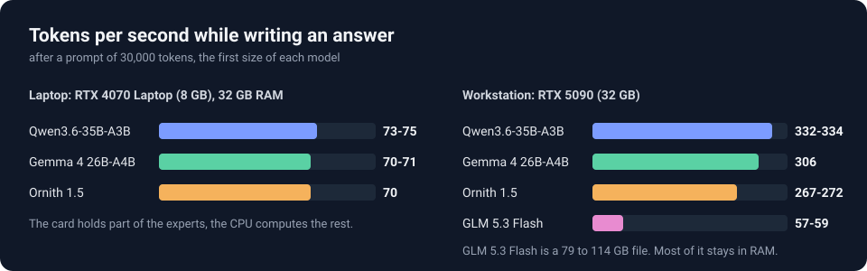
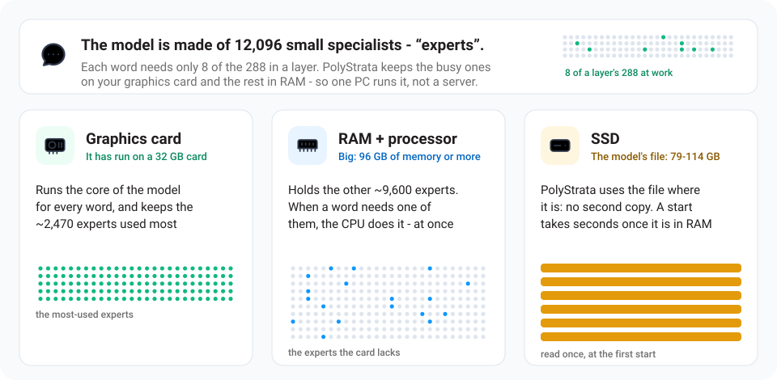
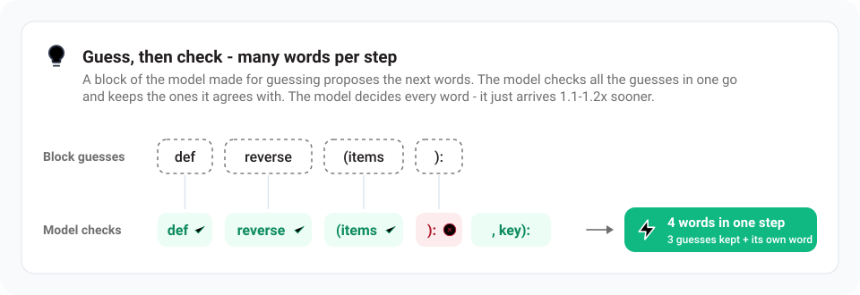
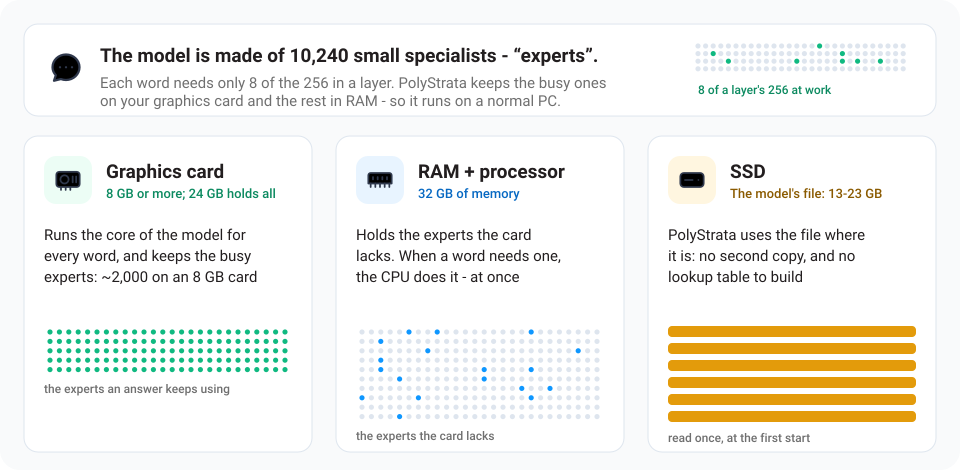

<h1 align="center">PolyStrata</h1>

[English](README.md) · **简体中文** · [日本語](README.ja.md) · [Deutsch](README.de.md) · [Français](README.fr.md) · [Español](README.es.md) · [Português](README.pt-BR.md)

<p align="center"><b>在你自己的电脑上运行大型 AI 模型</b><br>
Qwen3.8-Flash-Next、GLM 5.3 Flash、Qwen3.6、Ornith 1.5 和 Gemma 4 · 免费开源</p>

<p align="center"></p>

<p align="center"><a href="https://github.com/Niko1221/Strata/releases/download/v0.1.10/Pagoda.mp4"></a><br>
<sub>体素宝塔花园，一次提示生成，在 RTX 5070 上用 <a href="https://github.com/Niko1221/Strata">Strata</a> 运行（Qwen3.8-Flash-Next IQ3_S，128K 上下文）·
<a href="https://github.com/Niko1221/Strata/releases/download/v0.1.10/Pagoda.mp4">完整视频（49 秒）</a></sub></p>

PolyStrata 能在普通电脑上运行通常要用服务器才能跑的大型 AI 模型。它们能聊天、写代码，还能配合你的应用和编程智能体一起工作。
所有数据都留在你的电脑上。

它能跑五个模型，用两个引擎：

- **[Qwen3.8-Flash-Next](https://huggingface.co/Qwen/Qwen3.8-Flash-Next)**：12 GB 及以上的 NVIDIA 或 AMD 显卡，Windows 或
  Linux。它还能看图片。引擎是 Strata 项目的，没有改动。

另外四个用的是为 PolyStrata 写的引擎，需要一张 NVIDIA 显卡：四个都能在 Linux 上跑，三个小的也能在 Windows 上跑。
目前是实验性的：只在一台 32 GB 显卡的电脑上跑过，三个小的另外在一台 8 GB 显卡的笔记本上跑过。

- **[GLM 5.3 Flash](docs/GLM.md)**：最大的一个，文件 79 到 114 GB，大部分留在内存里。
- **[Qwen3.6-35B-A3B](docs/BACKENDS.md)**：文件 13 到 23 GB。它还能看图片。
- **[Ornith 1.5](docs/BACKENDS.md)**：结构和 Qwen3.6-35B-A3B 相同，权重不同，文件 14 到 24 GB。它还能看图片。
- **[Gemma 4 26B-A4B](docs/BACKENDS.md)**：文件 11 到 17 GB。它还能看图片。

服务器运行时可以在已安装的模型之间切换（[做法](docs/BACKENDS.md#changing-the-model)，英文）。

PolyStrata 基于 Niko1221 的 [Strata](https://github.com/Niko1221/Strata)。

## 速度有多快？

一个 token 大约相当于 ¾ 个英文单词。

- **写回答：** 短对话中回复出现的速度。每秒 60 个 token 已经比你的阅读速度还快。
- **读提示：** 读入你发送内容的速度（文档、代码或聊天记录）。

### Qwen3.8-Flash-Next

由 Strata 项目在两台普通的游戏电脑上测得，提示长 32K token。

<table>
<tr><th>NVIDIA：RTX 5070（12 GB）、Ryzen 5 7600、64 GB 内存</th><th>AMD：RX 9070 XT（16 GB）、Ryzen 9 3900X、47 GB 内存</th></tr>
<tr><td>

| 规格 | 写回答 | 读提示 |
| --- | ---: | ---: |
| **Q2_0** | 94 tokens/s | 2,650 tokens/s |
| **IQ2_XS** | 79 tokens/s | 2,090 tokens/s |
| **IQ3_XXS** | 62 tokens/s | 1,750 tokens/s |
| **IQ3_S** | 53 tokens/s | 1,620 tokens/s |
| **Coder** | 55 tokens/s | 2,180 tokens/s |

</td><td>

| 规格 | 写回答 | 读提示 |
| --- | ---: | ---: |
| **Q2_0** | 60 tokens/s | 1,160 tokens/s |
| **IQ2_XS** | 52 tokens/s | 1,110 tokens/s |
| **Coder** | 44 tokens/s | 1,420 tokens/s |

</td></tr>
</table>

NVIDIA：Q2_0 用的是引擎 0.1.36，其他各行用的是 0.1.26（4K 回答，32K 提示）。完整表格见
[DETAILS.md](docs/DETAILS.md#speed-measured)。显存越大的显卡越快：RTX 3090（24 GB）写回答应该能达到每秒约
100-140 个 token。长对话和其他显卡的数据：[各规格的速度](docs/MODELS.md#how-fast-is-each-size)、
[社区测试结果](docs/COMMUNITY_BENCHMARKS.md)。

### GLM 5.3 Flash

由 PolyStrata 在一台工作站上测得，提示长 28K token。

<table>
<tr><th>NVIDIA：RTX 5090（32 GB）、Xeon Platinum 8470Q（25 vCPU）、120 GB 内存</th></tr>
<tr><td>

| 规格 | 写回答 | 读提示 |
| --- | ---: | ---: |
| **3.0BIT** | 57-59 tokens/s | 784-785 tokens/s |
| **UD-IQ2_XXS** | 40-44 tokens/s | 1,020 tokens/s |
| **REAP50-Q3_K_M** | 56-62 tokens/s | 1,250 tokens/s |

</td></tr>
</table>

同一台电脑上用 llama.cpp 跑 3.0BIT 的文件，写回答每秒 26 个 token，读提示每秒约 265 个。GLM 5.3 Flash 比
其他几个模型大得多，这张卡的 32 GB 显存只放得下它约五分之一的专家，所以写得慢一些。
测了什么、怎么测的：[docs/GLM.md](docs/GLM.md#what-it-was-measured-on)。

### Qwen3.6-35B-A3B

由 PolyStrata 在两台电脑上测得，提示长 3 万到 3.2 万个 token：左边是一台 8 GB 显卡的笔记本，显卡放不下的专家由处理器来算；右边是一台工作站，显卡放得下整个模型。

<table>
<tr><th>NVIDIA：RTX 4070 Laptop（8 GB）、Core i7-14700HX、32 GB 内存</th><th>NVIDIA：RTX 5090（32 GB）、Xeon Platinum 8470Q（25 vCPU）、120 GB 内存</th></tr>
<tr><td>

| 规格 | 写回答 | 读提示 |
| --- | ---: | ---: |
| **UD-Q3_K_M** | 73-75 tokens/s | 1,390 tokens/s |
| **UD-Q2_K_XL** | 91 tokens/s | 1,320 tokens/s |
| **UD-Q4_K_M** | 58-61 tokens/s | 1,100-1,350 tokens/s |

</td><td>

| 规格 | 写回答 | 读提示 |
| --- | ---: | ---: |
| **UD-Q3_K_M** | 332-334 tokens/s | 5,520-5,580 tokens/s |
| **UD-Q2_K_XL** | 368-369 tokens/s | 5,540-5,580 tokens/s |
| **UD-Q4_K_M** | 333-337 tokens/s | 5,630-5,660 tokens/s |

</td></tr>
</table>

提示短一些读得更快：10,000 个 token 的提示，笔记本每秒读 1,450 个，工作站每秒读 5,500 个。在工作站的显卡上用 llama.cpp 把整个模型放进显存，
写回答每秒约 180 个 token，读提示每秒 6,000 到 9,000 个；它要求显卡放得下整个模型。
把工作站的显卡限制到 8 GB 的那组数字是笔记本测出来之前的替身，现在放在 [docs/BACKENDS.md](docs/BACKENDS.md#with-8-gb-of-vram)（英文）里。

### Ornith 1.5

测法相同，用的是同样的两台电脑。

<table>
<tr><th>NVIDIA：RTX 4070 Laptop（8 GB）、Core i7-14700HX、32 GB 内存</th><th>NVIDIA：RTX 5090（32 GB）、Xeon Platinum 8470Q（25 vCPU）、120 GB 内存</th></tr>
<tr><td>

| 规格 | 写回答 | 读提示 |
| --- | ---: | ---: |
| **APEX-I-COMPACT** | 70 tokens/s | 1,340 tokens/s |
| **APEX-I-MINI** | 63-68 tokens/s | 1,300-1,310 tokens/s |
| **APEX-I-QUALITY** | 42-48 tokens/s | 1,290-1,320 tokens/s |

</td><td>

| 规格 | 写回答 | 读提示 |
| --- | ---: | ---: |
| **APEX-I-COMPACT** | 267-272 tokens/s | 5,700-5,890 tokens/s |
| **APEX-I-MINI** | 265-279 tokens/s | 5,450-5,510 tokens/s |
| **APEX-I-QUALITY** | 263-265 tokens/s | 5,600-5,610 tokens/s |

</td></tr>
</table>

10,000 个 token 的提示，笔记本每秒读 1,380 个，工作站每秒读 5,500 个。在工作站的显卡上用 llama.cpp 把整个模型放进显存，
写回答每秒约 180 个 token，读提示每秒 6,000 到 9,000 个。

### Gemma 4 26B-A4B

测法相同，用的是同样的两台电脑。

<table>
<tr><th>NVIDIA：RTX 4070 Laptop（8 GB）、Core i7-14700HX、32 GB 内存</th><th>NVIDIA：RTX 5090（32 GB）、Xeon Platinum 8470Q（25 vCPU）、120 GB 内存</th></tr>
<tr><td>

| 规格 | 写回答 | 读提示 |
| --- | ---: | ---: |
| **UD-Q3_K_M** | 70-71 tokens/s | 1,910 tokens/s |
| **UD-Q2_K_XL** | 86-87 tokens/s | 1,840 tokens/s |
| **UD-Q4_K_M** | 67 tokens/s | 1,840 tokens/s |

</td><td>

| 规格 | 写回答 | 读提示 |
| --- | ---: | ---: |
| **UD-Q3_K_M** | 306 tokens/s | 7,170-7,210 tokens/s |
| **UD-Q2_K_XL** | 315 tokens/s | 6,920 tokens/s |
| **UD-Q4_K_M** | 301 tokens/s | 7,120-7,210 tokens/s |

</td></tr>
</table>

10,000 个 token 的提示，笔记本每秒读 1,950 个，工作站每秒读 5,500 个。在工作站的显卡上用 llama.cpp 把整个模型放进显存，
写回答每秒约 165 个 token，读提示每秒 6,000 到 9,000 个。

用 PolyStrata 自己引擎的这四个模型，都是用它自带的跑分测的，你也可以在自己的电脑上跑：
`python polystrata.py benchmark --model <name> --prompt-tokens 24000`
（[它发什么、打印什么](docs/BACKENDS.md#benchmark)，英文）。

## 你需要什么

### Qwen3.8-Flash-Next

| | |
| --- | --- |
| **显卡** | **NVIDIA** GeForce RTX 20、30、40 或 50 系列，或 **AMD** Radeon RX 7900 XT / XTX、RX 7800 XT / 7700 XT、RX 9060 XT、RX 9070 / 9070 XT、Radeon AI PRO R9700 或 RX 6800 / 6900 系列。需要 **12 GB 或以上显存**。 |
| **内存** | 32 GB 或以上。内存大小决定能装下[哪个规格](#该选哪个模型)。64 GB 可以运行所有规格。 |
| **硬盘** | 约 80 GB 可用空间。尽量用 SSD：第一次启动会快很多。 |
| **系统** | Windows 10 / 11 或 Linux，以及 NVIDIA 或 AMD 的最新显卡驱动。 |

其他的都由安装程序搞定。两到三张显卡可以分担同一个模型（[多 GPU](docs/MULTI_GPU.md)）。

实验性支持，由社区成员在自己的机器上编写和测试：

- **较老的显卡**（Tesla P40 / V100、GTX 10、Radeon VII / MI50、RX 6700 XT、RX 5500 XT）：[较老的 GPU](docs/OLDER_GPUS.md)。
- **Intel Arc**，在 Linux 上从源码构建：[Intel Arc](docs/INTEL_ARC.md)。
- **AMD Ryzen AI Max（Strix Halo）**，在 Linux 上从源码构建：[Strix Halo](docs/STRIX_HALO.md)。
- **不支持 AVX2 的老处理器**：能用，但很慢。[较老的 CPU](docs/INSTALL.md#older-cpus-experimental)。

完整列表：[docs/INSTALL.md](docs/INSTALL.md#what-you-need)。

### GLM 5.3 Flash

| | |
| --- | --- |
| **显卡** | 一张 **NVIDIA** GeForce RTX 20 系列或更新的显卡。目前只在 **32 GB 显存**上跑过。放专家之前就要占掉约 12 GB，所以 12 GB 的卡启动不了。 |
| **内存** | 配 32 GB 显卡时，完整模型需要 **96 GB 或以上**，2 bit 的规格需要 82 GB，专家减半的规格需要 60 GB。显卡越小，需要的内存越多（[具体多少](#该选哪个模型)）。实际跑过的是 120 GB。 |
| **硬盘** | 模型文件 114 GB、102 GB 或 79 GB，要放在 SSD 上。 |
| **系统** | Linux，以及 NVIDIA 的最新显卡驱动。 |

其他的都由安装程序搞定。它会在你的电脑上编译引擎，缺 g++ 和 CUDA 工具包时会提出帮你装。
暂时不支持：Windows、AMD 显卡、多张显卡、图片。

完整列表：[docs/GLM.md](docs/GLM.md#what-you-need)。

### Qwen3.6-35B-A3B

| | |
| --- | --- |
| **显卡** | 一张 **NVIDIA** GeForce RTX 20 系列或更新的显卡，**8 GB 或以上显存**。放专家之前要占掉约 5 GB。在 32 GB 的卡上跑过，在把这张卡限制到 8 GB 的情况下跑过，也在笔记本的 8 GB 显卡上跑过。 |
| **内存** | 配 8 GB 显卡，三个规格分别约需 **17、21、27 GB**，这是安装程序的估算。24 GB 的显卡能放下较小两个规格的整个模型。三个规格都在一台 32 GB 内存的笔记本上跑过。 |
| **硬盘** | 模型文件 13、17 或 23 GB，要看图片再加 1 GB。 |
| **系统** | Linux 或 Windows 10 / 11，以及 NVIDIA 的最新显卡驱动。 |

其他的都由安装程序搞定，和 GLM 5.3 Flash 一样。在 Windows 上，安装程序用 Visual Studio 的 2022 编译器和 CUDA 工具包
编译引擎，缺的话会问你要不要装。暂时不支持：AMD 显卡、多张显卡。

### Ornith 1.5

| | |
| --- | --- |
| **显卡** | 一张 **NVIDIA** GeForce RTX 20 系列或更新的显卡，**8 GB 或以上显存**。放专家之前要占掉约 4 GB。在 32 GB 的卡上跑过，在把这张卡限制到 8 GB 的情况下跑过，也在笔记本的 8 GB 显卡上跑过。 |
| **内存** | 配 8 GB 显卡，三个规格分别约需 **18、22、28 GB**，这是安装程序的估算。24 GB 的显卡能放下较小两个规格的整个模型。三个规格都在一台 32 GB 内存的笔记本上跑过。 |
| **硬盘** | 模型文件 14、17 或 24 GB，要看图片再加 1 GB。 |
| **系统** | Linux 或 Windows 10 / 11，以及 NVIDIA 的最新显卡驱动。 |

其他的都由安装程序搞定，和 GLM 5.3 Flash 一样。在 Windows 上，安装程序用 Visual Studio 的 2022 编译器和 CUDA 工具包
编译引擎，缺的话会问你要不要装。暂时不支持：AMD 显卡、多张显卡。

### Gemma 4 26B-A4B

| | |
| --- | --- |
| **显卡** | 一张 **NVIDIA** GeForce RTX 20 系列或更新的显卡，**8 GB 或以上显存**。放专家之前要占掉约 6 GB。在 32 GB 的卡上跑过，在把这张卡限制到 8 GB 的情况下跑过，也在笔记本的 8 GB 显卡上跑过。 |
| **内存** | 配 8 GB 显卡，三个规格分别约需 **15、18、21 GB**，这是安装程序的估算。按同样的估算，16 GB 的显卡能放下较小两个规格的整个模型。三个规格都在一台 32 GB 内存的笔记本上跑过。 |
| **硬盘** | 模型文件和它的草稿模型共 11、13 或 17 GB，要看图片再加 1 GB。 |
| **系统** | Linux 或 Windows 10 / 11，以及 NVIDIA 的最新显卡驱动。 |

其他的都由安装程序搞定，和 GLM 5.3 Flash 一样。在 Windows 上，安装程序用 Visual Studio 的 2022 编译器和 CUDA 工具包
编译引擎，缺的话会问你要不要装。暂时不支持：AMD 显卡、多张显卡。

这三个模型各自需要什么、是怎么验证的：[docs/BACKENDS.md](docs/BACKENDS.md#install)（英文）。

## 安装

### 让你的 AI 帮你装

你在用 AI 编程助手吗（Claude Code、Cursor、Codex、GitHub Copilot 等）？把下面这段粘贴给它：

```text
Set up PolyStrata on this PC for me: https://github.com/VecSzn/PolyStrata - follow docs/AI_SETUP.md in that repository.
```

它会检查你的显卡、内存和硬盘，选出合适的模型。然后安装并启动它，再告诉你怎么连接你的应用。AI 工具也可以通过
PolyStrata 的 [MCP 服务器](docs/MCP_SERVER.md)来安装、启动和停止 PolyStrata。

### 或者自己动手

[下载 PolyStrata](https://github.com/VecSzn/PolyStrata/archive/refs/heads/main.zip) 并解压（或者用 `git clone`）。
**Windows：** 双击 **`START-HERE.bat`**。**Linux：** 在 PolyStrata 文件夹里运行 **`./setup.sh`**。

安装程序会识别你的显卡，并装好对应的引擎。它会问你几个问题：

- 用哪个模型、哪个规格，
- 上下文多大（模型能记住多少文字），
- 是否要识别图片（GLM 5.3 Flash 不支持）。

每次直接按回车就是推荐选项。之后它会下载模型（Qwen3.8-Flash-Next 约 70 GB，GLM 5.3 Flash 79 到 114 GB，另外三个 11 到 24 GB）并启动。
如果下载中断了，再运行一次即可：它会从中断的地方继续。浏览器会打开 PolyStrata 应用，地址是 `http://127.0.0.1:8080`。

五个模型都在安装程序的模型列表里。想直接装其中一个，运行 `./setup.sh --family glm`（或 `qwen36`、`ornith`、`gemma4`）
（[它会问什么、写什么](docs/GLM.md#install)）。

> **模型启动时，你的电脑可能会变慢或卡住 1-3 分钟**（第一次最久）。
> PolyStrata 会把 35-55 GB 加载到内存，并为显卡锁定其中一部分。这是正常的。请耐心等待，不要关闭窗口。
> 窗口里会显示 PolyStrata 正在做什么。

**下次使用时**，再运行一次 `START-HERE.bat`（或 `./setup.sh`）。它会马上启动，已下载的东西不会重复下载。关闭它的窗口就能停止模型。
`UPDATE.bat`（`./update.sh`）只更新 PolyStrata，不启动。更新、Docker、多张显卡、文件存放位置以及所有选项：
[docs/INSTALL.md](docs/INSTALL.md)。

## 该选哪个模型

### Qwen3.8-Flash-Next

安装程序会根据你的内存推荐一个。同一个模型有几种规格，压缩程度不同。规格越小越快，越大越聪明一些。

| 你的内存 | 选择 | 原因 |
| --- | --- | --- |
| **32 GB** | **Coder** | 32 GB 装得下，而且专为代码打造（如果显卡是 24 GB，Q2_0 和 IQ2_XS 也能跑） |
| **48 GB** | **IQ2_XS**（或 Q2_0，最快） | 更大的规格装不下 |
| **64 GB** | **IQ2_XS**（推荐），或 IQ3_XXS / IQ3_S | 所有规格都装得下；IQ3_S 最好，也最慢 |
| **96 GB 或以上** | **IQ3_S**，或 Unsloth 的 UD-IQ4_XS（约 4-bit） | 开着其他程序也能放下最大的规格 |

- **[Coder](docs/MODELS.md#coder)：** 编程版本，去掉了一半专家。它达到完整模型 SWE-bench Verified 分数的 91%（由其作者测得），
  32 GB 内存就能装下。代码以外的能力较弱，包括中文和其他中日韩文本（#438）。这类用途请选 Q2_0、IQ2_XS 或 IQ3_S，
  它们保留了所有专家。
- **[Swift 1.5](docs/MODELS.md#swift-15)：** 一个微调版本，回答前思考的时间短得多。你能更早拿到答案，质量基本不变。
- **[Unsloth UD-IQ4_XS](docs/MODELS.md#unsloth-ud-iq4_xs)：** Unsloth 的约 4-bit 版本，质量介于 IQ3_S 和 UD-Q4_K_XL 之间。
  下载 94 GB。内存少于约 80 GB 时，PolyStrata 回答时要从 SSD 读取其中一部分，所以会更慢（NVMe SSD 有帮助）。
- **[Unsloth UD-Q4_K_XL](docs/MODELS.md#unsloth-ud-q4_k_xl-experimental)**（实验性）：最接近完整模型。但 PolyStrata
  回答时要从 SSD 读取其中大部分内容，所以在 64 GB 的电脑上每秒只能写 7-8.5 个 token。
- **[OrcaRouter 的 Uncensored IQ3_XXS](docs/MODELS.md#orcarouter-uncensored-iq3_xxs)：** 需要手动设置，不在安装程序的菜单里。

规格、下载以及各配置能装下什么：[docs/MODELS.md](docs/MODELS.md)。以后想再添加模型，运行
`SETUP.bat`（Linux：`./setup.sh --setup`）。

### GLM 5.3 Flash

目前有三个规格，安装程序会选内存够用的第一个。

| 规格 | 是什么 | 下载 | 配 32 GB 显卡需要的内存 |
| --- | --- | ---: | ---: |
| **3.0BIT** | 完整模型，约 3 bit（[neuralll](https://huggingface.co/neuralll/GLM-5.3-Flash-GSQ-RCO-3.0bit-Q4Kattn-GGUF)） | 114 GB | 96 GB |
| **UD-IQ2_XXS** | 完整模型，约 2 bit（[Unsloth](https://huggingface.co/unsloth/GLM-5.3-Flash-GGUF)）：读提示更快，写回答更慢 | 102 GB | 82 GB |
| **REAP50-Q3_K_M** | 去掉了一半的路由专家（patrickbdevaney 的 [REAP50](https://huggingface.co/patrickbdevaney/GLM-5.3-Flash-REAP50-GGUF)） | 79 GB | 60 GB |

需要多少内存取决于你的显卡，因为显卡放不下的专家都得留在内存里。

| 你的显卡 | 3.0BIT | UD-IQ2_XXS | REAP50-Q3_K_M | |
| --- | ---: | ---: | ---: | --- |
| **32 GB** | **96 GB** | **82 GB** | **60 GB** | 跑过的就是这台电脑，内存 120 GB |
| **24 GB** | 约 104 GB | 约 90 GB | 约 68 GB | 还没跑过 |
| **16 GB** | 约 113 GB | 约 99 GB | 约 77 GB | 还没跑过 |
| **12 GB 或以下** | | | | 启动不了 |

内存数字是安装程序根据唯一跑过的那台电脑估算的。内存不够也能启动，但回答时要从 SSD 读专家，会慢很多。
安装程序会先说明并征求你的同意。

GLM 5.3 Flash 的其他量化版本暂时不支持：[还缺什么](docs/GLM.md#what-is-missing)。

### Qwen3.6-35B-A3B

目前有三个规格。安装程序默认选 UD-Q3_K_M，内存不够时选 UD-Q2_K_XL；UD-Q4_K_M 要指名：`--model UD-Q4_K_M`。

| 规格 | 是什么 | 下载 | 配 8 GB 显卡需要的内存 |
| --- | --- | ---: | ---: |
| **UD-Q3_K_M** | 完整模型，专家是 3 bit（[Unsloth](https://huggingface.co/unsloth/Qwen3.6-35B-A3B-MTP-GGUF)） | 17 GB | 约 21 GB |
| **UD-Q2_K_XL** | 同上，专家是 2 bit 和 3 bit：需要的内存最少 | 13 GB | 约 17 GB |
| **UD-Q4_K_M** | 同上，专家是 4 bit | 23 GB | 约 27 GB |

显卡越大，放得下的模型越多，需要的内存越少：UD-Q3_K_M 配 12 GB 显卡约 17 GB，配 16 GB 显卡约 13 GB，整个模型都放进显卡之后是 10 GB。
这些是安装程序的估算，还没有在这样的电脑上验证过。

### Ornith 1.5

目前有三个规格。安装程序默认选 APEX-I-COMPACT，内存不够时选 APEX-I-MINI；APEX-I-QUALITY 要指名：`--model APEX-I-QUALITY`。

| 规格 | 是什么 | 下载 | 配 8 GB 显卡需要的内存 |
| --- | --- | ---: | ---: |
| **APEX-I-COMPACT** | 完整模型，专家是 3 bit 和 4 bit（mudler 的 [APEX](https://huggingface.co/mudler/Ornith-1.5-35B-A3B-APEX-MTP-GGUF)） | 17 GB | 约 22 GB |
| **APEX-I-MINI** | 同上，专家是 2 bit 和 3 bit：需要的内存最少 | 14 GB | 约 18 GB |
| **APEX-I-QUALITY** | 同上，专家是 4 到 6 bit | 24 GB | 约 28 GB |

显卡越大，放得下的模型越多，需要的内存越少：APEX-I-COMPACT 配 12 GB 显卡约 17 GB，配 16 GB 显卡约 13 GB，整个模型都放进显卡之后是 10 GB。
这些是安装程序的估算，还没有在这样的电脑上验证过。

### Gemma 4 26B-A4B

目前有三个规格。安装程序默认选 UD-Q3_K_M，内存不够时选 UD-Q2_K_XL；UD-Q4_K_M 要指名：`--model UD-Q4_K_M`。

| 规格 | 是什么 | 下载 | 配 8 GB 显卡需要的内存 |
| --- | --- | ---: | ---: |
| **UD-Q3_K_M** | 完整模型，专家是 3 bit（[Unsloth](https://huggingface.co/unsloth/gemma-4-26B-A4B-it-GGUF)），外加 Google 给它配的草稿模型 | 13 GB | 约 18 GB |
| **UD-Q2_K_XL** | 同上，专家是 2 bit：需要的内存最少 | 11 GB | 约 15 GB |
| **UD-Q4_K_M** | 同上，专家是 4 bit 和 5 bit | 17 GB | 约 21 GB |

显卡越大，放得下的模型越多，需要的内存越少：UD-Q3_K_M 配 12 GB 显卡约 14 GB，整个模型都放进显卡之后是 10 GB。
这些是安装程序的估算，还没有在这样的电脑上验证过。

## 使用方法

五个模型的用法一样：同一个应用，同一套 API。

<p align="center"><br>
<sub>应用的 <b>Monitor</b>（左），编程智能体正在写视频里的宝塔花园（右）。截图来自 <a href="https://github.com/Niko1221/Strata">Strata</a>。</sub></p>

- **在浏览器里：** 打开 `http://127.0.0.1:8080`。里面有 **Chat**（聊天）、实时 **Monitor**（监控模型和你的
  GPU/CPU/内存），以及 **About**（设置和地址）。
- **你的应用和编程智能体：** 添加一个“OpenAI 兼容”的提供商，base URL 填 **`http://127.0.0.1:8080/v1`**。
  API key 和模型名随便填都行。
  - 使用 Anthropic API 的应用：`http://127.0.0.1:8080/v1/messages`（Claude Code：
    `ANTHROPIC_BASE_URL=http://127.0.0.1:8080`）。
  - Codex CLI 和其他使用 OpenAI Responses API 的应用：`/v1/responses`
    （[设置方法](docs/DETAILS.md#the-responses-api-and-codex-cli)）。
- **思考：** 在聊天菜单或应用的“reasoning effort”里选择 **off、low、medium 或 high**。off 最快，
  high 最适合难题。
- **从手机或另一台电脑访问：** `START-HERE.bat --setup --host 0.0.0.0 --api-key <secret>`。一定要设置 key。

它们不一样的地方：

| | Qwen3.8-Flash-Next | GLM 5.3 Flash | Qwen3.6-35B-A3B、Ornith 1.5、Gemma 4 26B-A4B |
| --- | --- | --- | --- |
| **图片** | 在安装时对“Images?”选是。然后在聊天里点 **Picture**，或在你的应用里附上图片。AMD 显卡在 Linux 上通过处理器识别图片；在 Windows 上暂时还不行。 | 暂时不支持。 | 在安装时对“Images?”选是，之后和 Qwen3.8-Flash-Next 一样。显存不到 16 GB 的卡上，图片编码器在处理器上跑，一张图片要几秒。 |
| **多个请求** | 默认一次只回答一个，其他请求排队等待。设置 `"parallel": 2` 可以同时回答多个（[BATCHING.md](docs/BATCHING.md)）；在 12 GB 显卡上，这会让每个回答变慢。 | 一次只回答一个，其他请求排队等待。 | 一次只回答一个，其他请求排队等待。 |
| **多个对话** | 保留最近的一个对话，所以后续消息几秒内就开始回答。加两个引擎参数可以在内存里保留多个（[详情](docs/DETAILS.md#using-it)）。 | 保留最近的一个对话。安装程序会问要不要在内存里保留多个，这样智能体和子代理轮流请求时不用重读提示（[原理](docs/GLM.md#several-conversations-at-once)）。 | 和 GLM 5.3 Flash 一样。 |
| **长提示** | 对话的第一条消息要完整读入，大约每 30,000 个 token 需要 1 分钟。 | 第一条消息要完整读入，大约每 30,000 个 token 需要 40 秒。 | 第一条消息要完整读入：30,000 个 token，工作站要 6 到 8 秒，8 GB 显卡的笔记本要 16 到 22 秒。 |

更多：[聊天记录存在哪里](docs/INSTALL.md#where-things-are-stored)、[API](docs/DETAILS.md#using-it)。

## 出问题了？

- **PolyStrata 第一次启动时电脑卡死了。** 加载模型时这是正常的。请耐心等待，不要关闭窗口。
  10 分钟后还卡着？重启电脑，关掉其他程序再试一次，或者换一个更小的规格。
- **下载或安装时中断了。** 再运行一次 `START-HERE.bat`（或 `./setup.sh`）。它会从中断的地方继续。
- **非常慢，硬盘灯一直闪，或者提示“the engine stopped unexpectedly”。** 你的电脑可用内存不够。
  关掉其他程序（浏览器很占内存），或者换一个更小的规格（Q2_0 或 IQ2_XS）。
- **提示 8080 端口已被占用。** PolyStrata 已经在运行了。找一下它的窗口。

更多问题和解决办法：[docs/TROUBLESHOOTING.md](docs/TROUBLESHOOTING.md)。还是解决不了？提交一个
[issue](https://github.com/VecSzn/PolyStrata/issues)，并附上 PolyStrata 文件夹里的 `strata-<model>.log`。发现了安全问题？
请私下报告：[SECURITY.md](SECURITY.md)。

## 它是怎么工作的？

这类模型通常运行在拥有数百 GB 显存的服务器上。而你的显卡只有 8-32 GB。PolyStrata 让模型装得下的办法是
**把工作分摊到整台电脑上**。可以想象一个厨房：常用的东西放在台面上，其余的放在储藏室里。

### Qwen3.8-Flash-Next

<p align="center"></p>

- **这个模型是由 24,576 个小专家（“experts”）组成的团队。** 每个词只需要其中 10 个。
- **你的显卡** 存放最常用的几千个专家。**你的内存** 存放全部专家，
  **你的处理器** 同时处理其余的部分。**你的 SSD** 存放一张大查找表。

<p align="center"></p>

- **先猜，再检查：** 一个小助手先猜接下来的几个词，大模型再一次性检查它们。答案完全一样，但快 1.6-1.8 倍。
- **长文本分大块读入**（每次最多 8,192 个 token），速度超过每秒 1,000 个 token。

更详细的解释：[docs/HOW_IT_WORKS.md](docs/HOW_IT_WORKS.md)。每个部分及其数据：
[详细说明](docs/DETAILS.md#how-it-works)和[论文](docs/paper/Strata-Paper.pdf)。

### GLM 5.3 Flash

<p align="center"></p>

- **这个模型是由 12,096 个小专家组成的团队**，42 层，每层 288 个。每个词只需要从每一层里用 8 个。
- **你的显卡** 存放最常用的那些，32 GB 的卡上约 2,470 个：引擎会统计你的使用中哪些专家用得多，下次启动时重新挑选。
  **你的内存** 存放其余的，**你的处理器** 同时把它们算出来。**你的 SSD** 存放模型文件，文件原地使用，硬盘上不会多出一份副本；
  文件进了内存缓存之后，启动只要 6 秒左右。

<p align="center"></p>

- **先猜，再检查：** 模型里有一个专门用来预猜的模块，由它先猜接下来的几个词，模型再一次性检查它们。答案完全一样，但快 1.1-1.2 倍。
- **长文本分大块读入**（每次 1,024 个 token，显卡放不下的专家分批经过显卡），每秒读 780 到 1,250 个 token。

每个部分及其数据：[docs/GLM.md](docs/GLM.md#how-it-uses-the-card)。

### Qwen3.6-35B-A3B

<p align="center"></p>

- **这个模型是由 10,240 个小专家组成的团队**，40 层，每层 256 个。每个词只需要从每一层里用 8 个。
- **你的显卡** 能放多少放多少：8 GB 的卡上约 2,000 个，24 GB 起就能全部放下。写回答时，引擎会把回答反复选中的专家换进显存，
  在 8 GB 的卡上，回答用到的专家里约有 55% 由显卡提供。**你的内存** 存放其余的，**你的处理器** 同时把它们算出来。
  **你的 SSD** 存放模型文件，文件原地使用，硬盘上不会多出一份副本。

<p align="center"></p>

- **先猜，再检查：** 模型文件里自带一个预猜模块，由它先猜接下来的几个词，模型再一次性检查它们。答案完全一样，但快 1.2-1.5 倍。
- **长文本分大块读入**（每次 1,024 个 token）。显卡放不下全部专家时，其余的专家在整段提示里只经过显卡一遍。

每个部分及其数据：[docs/BACKENDS.md](docs/BACKENDS.md#how-a-backend-works)（英文）。

### Ornith 1.5

<p align="center"></p>

- **结构和 Qwen3.6-35B-A3B 相同，权重不同：** 10,240 个小专家组成的团队，40 层，每层 256 个，每个词只需要从每一层里用 8 个。
- **你的显卡** 能放多少放多少：8 GB 的卡上约 2,500 个，24 GB 起就能全部放下。写回答时，引擎会把回答反复选中的专家换进显存，
  在 8 GB 的卡上，回答用到的专家里约有 60% 由显卡提供。**你的内存** 存放其余的，**你的处理器** 同时把它们算出来。
  **你的 SSD** 存放模型文件，文件原地使用，硬盘上不会多出一份副本。

<p align="center"></p>

- **先猜，再检查：** 它的预猜模块也在模型文件里，由它先猜接下来的几个词。它猜对的比例比 Qwen3.6-35B-A3B 的低，所以同样的答案快 1.1-1.2 倍。
- **长文本分大块读入**（每次 1,024 个 token）。显卡放不下全部专家时，其余的专家在整段提示里只经过显卡一遍。

每个部分及其数据：[docs/BACKENDS.md](docs/BACKENDS.md#how-a-backend-works)（英文）。

### Gemma 4 26B-A4B

<p align="center"></p>

- **这个模型是由 3,840 个小专家组成的团队**，30 层，每层 128 个。每个词只需要从每一层里用 8 个，另外每层还有一部分是每个词都要用的。
- **你的显卡** 能放多少放多少：8 GB 的卡上约 640 个，按安装程序的估算 16 GB 起就能全部放下。写回答时，引擎会把回答反复选中的
  专家换进显存，在 8 GB 的卡上，回答用到的专家里约有 55% 由显卡提供。**你的内存** 存放其余的，**你的处理器** 同时把它们算出来。
  **你的 SSD** 存放模型文件和它的草稿模型，都是原地使用，硬盘上不会多出一份副本。

<p align="center"></p>

- **先猜，再检查：** Google 给它配了一个小的草稿模型，文件 0.5 GB，安装程序会和模型一起下载，由它先猜接下来的几个词，
  模型再一次性检查它们。答案完全一样，但快 1.3-1.6 倍。
- **长文本分大块读入**（每次 1,024 个 token）。显卡放不下全部专家时，其余的专家在整段提示里只经过显卡一遍。

每个部分及其数据：[docs/BACKENDS.md](docs/BACKENDS.md#how-a-backend-works)（英文）。

## 致谢与许可证

Qwen3.8-Flash-Next 来自 [Qwen 团队](https://huggingface.co/Qwen/Qwen3.8-Flash-Next)，由
[ISTA-DASLab](https://huggingface.co/ISTA-DASLab/Qwen3.8-Flash-Next-GSQ-RCO-GGUF)、UkisAI（Swift 1.5）
和 Unsloth 压缩。GLM 5.3 Flash 用的是
[neuralll](https://huggingface.co/neuralll/GLM-5.3-Flash-GSQ-RCO-3.0bit-Q4Kattn-GGUF)、Unsloth 和 patrickbdevaney 的文件。
Qwen3.6-35B-A3B 来自 Qwen 团队，Gemma 4 来自 Google，用的都是 [Unsloth](https://huggingface.co/unsloth) 的量化版本。Ornith 1.5 来自
ornith-ai，用的是 [mudler](https://huggingface.co/mudler/Ornith-1.5-35B-A3B-APEX-MTP-GGUF) 的 APEX 量化版本。PolyStrata 基于
Niko1221 和各位贡献者的 [Strata](https://github.com/Niko1221/Strata)，并使用了
[llama.cpp / ggml](https://github.com/ggml-org/llama.cpp) 的部分代码。完整致谢：
[docs/HOW_IT_WORKS.md](docs/HOW_IT_WORKS.md#credits)。PolyStrata 以 [MIT 许可证](LICENSE)开源。少数部分和每个模型
有各自的许可证（[具体是哪些](docs/HOW_IT_WORKS.md#license)）。
